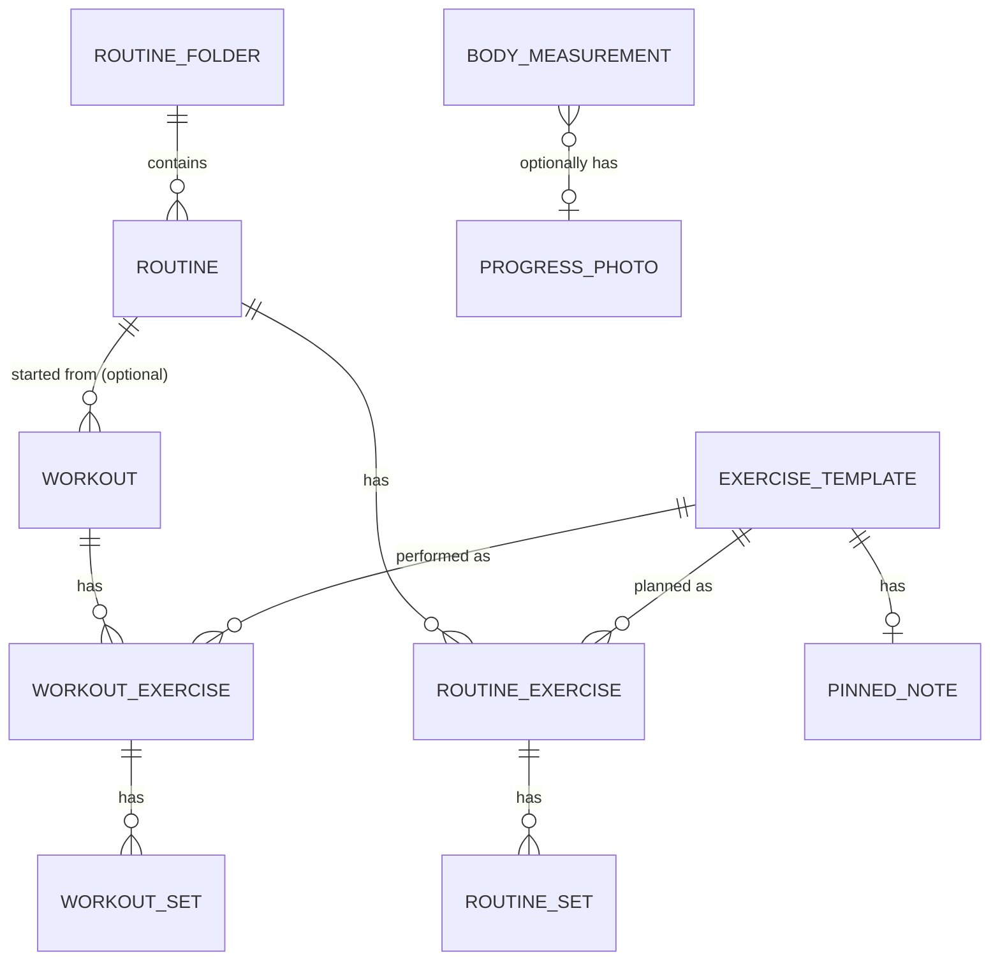

# 04 — Data Model

**Provenance:** Entity and field names come from open-source clients of Hevy's public API (Rust, Go, Python, TypeScript/MCP) **[API]**. The UI-level concepts come from Hevy's docs **[OFFICIAL]**. The SQL schema at the bottom is **my proposal [INFERENCE]** shaped to match those concepts, plus clearly-marked extensions that address known gaps.

---

## 1. Concept map



- **Template vs instance:** `ExerciseTemplate` is the library entry ("Bench Press (Barbell)"). A workout contains *instances* of templates (`WorkoutExercise`) which contain sets. Routines mirror that structure but hold *planned* values.
- **Supersets** are not a separate table in the API: exercises in a workout/routine share an integer `superset_id`. **[API]**
- **Order** is stored via an `index` (0-based) on exercises and sets. **[API]**

## 2. Entities and fields

### 2.1 ExerciseTemplate [API]
| Field | Type | Notes |
|---|---|---|
| id | string (UUID-like) | Built-in and custom both have ids |
| title | string | e.g., "Bench Press (Barbell)" — Hevy puts equipment in parentheses in the title |
| type (`exercise_type` on create) | enum (8) | `weight_reps`, `reps_only`, `bodyweight_reps`, `bodyweight_assisted_reps`, `duration`, `weight_duration`, `distance_duration`, `short_distance_weight` |
| primary_muscle_group | enum (20) | See file 02 |
| secondary_muscle_groups | enum[] | Used for muscle-volume stats |
| equipment_category | enum (9) | none, barbell, dumbbell, kettlebell, machine, plate, resistance_band, suspension, other |
| is_custom | bool | |

Sample (from a client test fixture): Bench Press (Barbell) → type `weight_reps`, primary `chest`, secondary `shoulders`,`triceps`, equipment `barbell`, is_custom `false`.

### 2.2 Workout [API]
| Field | Notes |
|---|---|
| id, title, description | |
| start_time, end_time | ISO-8601; **duration is derived** (editable by user on finish) |
| created_at, updated_at | |
| exercises[] | see below |

### 2.3 WorkoutExercise [API]
| Field | Notes |
|---|---|
| index | order within workout |
| title | denormalized name |
| notes | the session-specific exercise note |
| exercise_template_id | FK |
| superset_id | nullable int; same value = same superset |
| sets[] | |

### 2.4 WorkoutSet [API]
| Field | Type | Notes |
|---|---|---|
| index | int | 0-based |
| type | enum | `normal`, `warmup`, `dropset`, `failure` |
| weight_kg | number? | **Weight always in kg in the API**; UI converts to lbs |
| reps | number? | |
| distance_meters | number? | |
| duration_seconds | number? | |
| rpe | number? | Rate of perceived exertion; optional |
| custom_metric | number? | Appears in client models for sets/history — purpose not documented in what I read |

All value fields nullable: which ones are meaningful depends on the exercise `type`.

### 2.5 Routine / RoutineExercise / RoutineSet [API]
Routine: `id, title, folder_id (nullable), created_at, updated_at, exercises[]`.
RoutineExercise: like WorkoutExercise (`exercise_template_id`, `superset_id`, `notes`, `index`, `sets[]`).
RoutineSet: like WorkoutSet; in the UI also supports **rep ranges** and **rest timer per exercise**. Whether the API exposes rep-range / rest-seconds fields is **unverified** (see file 10).
Note: creating a routine via API takes `folder_id`, but **updating** a routine rejects `folder_id` (400). **[API/MCP notes]**

### 2.6 RoutineFolder [API]
`id, title` (+ ordering in UI).

### 2.7 BodyMeasurement [API: create endpoint exists]
UI supports weight, body fat %, and **14 circumference measurements**, one entry per day, any subset allowed **[OFFICIAL]**. The exact 14 names are **not verified**; likely neck, shoulders, chest, left/right bicep, left/right forearm, abdomen, waist, hips, left/right thigh, left/right calf **[INFERENCE — verify]**.

### 2.8 Not exposed by API but present in the app [OFFICIAL]
- **Pinned exercise note** (per exercise, shows everywhere it's used)
- **User settings** (default rest, previous-values mode, warm-up formula, plate inventory, RPE toggle, etc.)
- **Plate inventory & bar weights**, **warm-up ladder definition**, **dumbbell/plate rounding**
- **Progress photos**, workout media, privacy flags, likes/comments/follows (social)
- **PR records** (likely computed, not stored — unknown)

## 3. Derived values (computed, not stored) [INFERENCE unless noted]

| Value | Definition (see file 05 for formulas) |
|---|---|
| Set volume | weight × reps (for weight_reps types) |
| Session volume ("volume load") | Σ set volume over qualifying sets |
| Estimated 1RM | formula from weight & reps |
| Records | heaviest weight, best 1RM, best set volume, best session volume, most reps, best duration, best weight per rep-count |
| Sets per muscle | count qualifying sets grouped by primary (and possibly secondary) muscle |
| Streak | consecutive calendar weeks with ≥ 1 workout **[OFFICIAL]** |
| Workout ordinal | count of workouts up to this one |

## 4. Proposed SQLite schema (starting point) [INFERENCE]

```sql
-- Conventions: weights stored in kg; times in ISO-8601 UTC text (or unix ms); ids are TEXT (uuid/ulid).

CREATE TABLE exercise_template (
  id               TEXT PRIMARY KEY,
  title            TEXT NOT NULL,
  exercise_type    TEXT NOT NULL CHECK (exercise_type IN (
                     'weight_reps','reps_only','bodyweight_reps','bodyweight_assisted_reps',
                     'duration','weight_duration','distance_duration','short_distance_weight')),
  primary_muscle   TEXT NOT NULL,
  equipment        TEXT NOT NULL,
  is_custom        INTEGER NOT NULL DEFAULT 0,
  pinned_note      TEXT,                 -- Hevy's "pinned notes"
  default_rest_s   INTEGER,              -- (extension) fixes "remember rest per exercise" complaint
  archived         INTEGER NOT NULL DEFAULT 0,
  created_at       TEXT NOT NULL,
  updated_at       TEXT NOT NULL
);

CREATE TABLE exercise_template_secondary_muscle (
  exercise_template_id TEXT NOT NULL REFERENCES exercise_template(id) ON DELETE CASCADE,
  muscle               TEXT NOT NULL,
  PRIMARY KEY (exercise_template_id, muscle)
);

CREATE TABLE routine_folder (
  id TEXT PRIMARY KEY, title TEXT NOT NULL, position INTEGER NOT NULL DEFAULT 0
);

CREATE TABLE routine (
  id TEXT PRIMARY KEY,
  folder_id TEXT REFERENCES routine_folder(id) ON DELETE SET NULL,
  title TEXT NOT NULL,
  notes TEXT,                            -- routine-level note
  position INTEGER NOT NULL DEFAULT 0,
  created_at TEXT NOT NULL, updated_at TEXT NOT NULL
);

CREATE TABLE routine_exercise (
  id TEXT PRIMARY KEY,
  routine_id TEXT NOT NULL REFERENCES routine(id) ON DELETE CASCADE,
  position INTEGER NOT NULL,
  exercise_template_id TEXT NOT NULL REFERENCES exercise_template(id),
  superset_group INTEGER,                -- same value = superset
  notes TEXT,                            -- shown every time the routine is used
  rest_seconds INTEGER                   -- NULL = use default; 0 = off (decide convention)
);

CREATE TABLE routine_set (
  id TEXT PRIMARY KEY,
  routine_exercise_id TEXT NOT NULL REFERENCES routine_exercise(id) ON DELETE CASCADE,
  position INTEGER NOT NULL,
  set_type TEXT NOT NULL DEFAULT 'normal' CHECK (set_type IN ('normal','warmup','dropset','failure')),
  weight_kg REAL, reps INTEGER, reps_min INTEGER, reps_max INTEGER,   -- rep range support
  distance_m REAL, duration_s INTEGER, rpe_target REAL                -- (extension) RPE target
);

CREATE TABLE workout (
  id TEXT PRIMARY KEY,
  routine_id TEXT REFERENCES routine(id) ON DELETE SET NULL,  -- needed for "previous values within this routine"
  title TEXT NOT NULL,
  notes TEXT,
  start_time TEXT NOT NULL,
  end_time TEXT,
  created_at TEXT NOT NULL, updated_at TEXT NOT NULL,
  deleted_at TEXT                         -- soft delete helps sync/undo
);

CREATE TABLE workout_exercise (
  id TEXT PRIMARY KEY,
  workout_id TEXT NOT NULL REFERENCES workout(id) ON DELETE CASCADE,
  position INTEGER NOT NULL,
  exercise_template_id TEXT NOT NULL REFERENCES exercise_template(id),
  superset_group INTEGER,
  notes TEXT,                             -- session-only exercise note
  rest_seconds INTEGER
);

CREATE TABLE workout_set (
  id TEXT PRIMARY KEY,
  workout_exercise_id TEXT NOT NULL REFERENCES workout_exercise(id) ON DELETE CASCADE,
  position INTEGER NOT NULL,
  set_type TEXT NOT NULL DEFAULT 'normal' CHECK (set_type IN ('normal','warmup','dropset','failure')),
  weight_kg REAL, reps INTEGER, distance_m REAL, duration_s INTEGER,
  rpe REAL, custom_metric REAL,
  completed INTEGER NOT NULL DEFAULT 0,   -- the ✓ state during a live workout
  completed_at TEXT,                      -- (extension) enables rest-time analytics
  -- Extensions that address known Hevy gaps (see file 07):
  side TEXT CHECK (side IN ('both','left','right')) DEFAULT 'both',  -- unilateral logging
  partial_reps INTEGER                                                -- half/partial reps
);

CREATE TABLE body_measurement (
  id TEXT PRIMARY KEY,
  measured_on TEXT NOT NULL,              -- date
  weight_kg REAL, body_fat_pct REAL
);
CREATE TABLE body_measurement_value (     -- flexible: avoids hardcoding the 14 circumferences
  measurement_id TEXT NOT NULL REFERENCES body_measurement(id) ON DELETE CASCADE,
  kind TEXT NOT NULL,                     -- 'neck','chest','left_bicep',...
  value_cm REAL NOT NULL,
  PRIMARY KEY (measurement_id, kind)
);
CREATE TABLE progress_photo (
  id TEXT PRIMARY KEY, measurement_id TEXT REFERENCES body_measurement(id) ON DELETE SET NULL,
  taken_on TEXT NOT NULL, file_path TEXT NOT NULL
);

CREATE TABLE app_setting (key TEXT PRIMARY KEY, value TEXT NOT NULL);   -- JSON values: units, default rest, warm-up ladder, plates, toggles
CREATE TABLE plate_inventory (weight_kg REAL PRIMARY KEY, count_per_side INTEGER NOT NULL);

CREATE INDEX idx_we_template ON workout_exercise(exercise_template_id);
CREATE INDEX idx_ws_exercise ON workout_set(workout_exercise_id);
CREATE INDEX idx_workout_start ON workout(start_time);
```

### Design notes for the planner
1. **Store canonical kg; convert at the edge.** Avoids float drift and enables a per-exercise unit toggle.
2. **Keep `completed` on sets.** A live workout has uncompleted planned sets; only completed sets should count for stats/PRs. (Hevy's API returns finished workouts only — the "live" state is an app concept.)
3. **Snapshot vs reference:** Hevy denormalizes the exercise `title` into workout exercises. Decide whether renaming a template should rewrite history (reference) or not (snapshot). Referencing by id is simpler; keep a `title_at_time` if you want snapshots.
4. **Set-type effects live in code, not data** (drop-set → no rest timer; warm-ups optionally excluded from stats). Keep the rules centralized (file 05).
5. **`superset_group`** is just a label — compute adjacency/ordering in the UI.
6. **Soft-delete** workouts; Hevy's API exposes deletions only via an events feed (see file 06), suggesting a sync-oriented design.
7. **Extensions** (`side`, `partial_reps`, `rpe_target`, `default_rest_s`, `completed_at`) are not in Hevy — they're where your version can be *better*.
